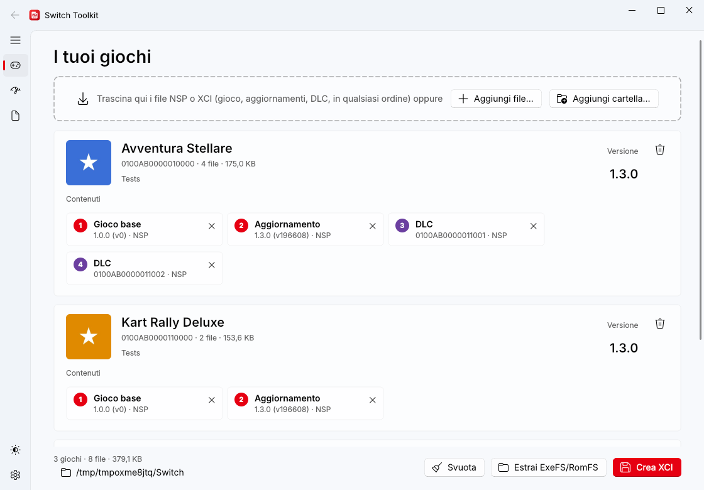
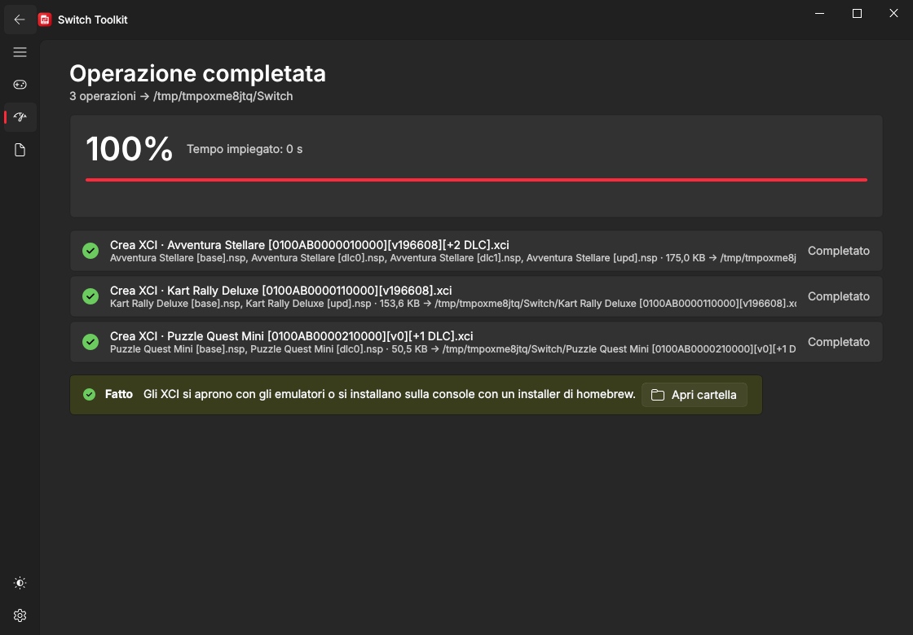
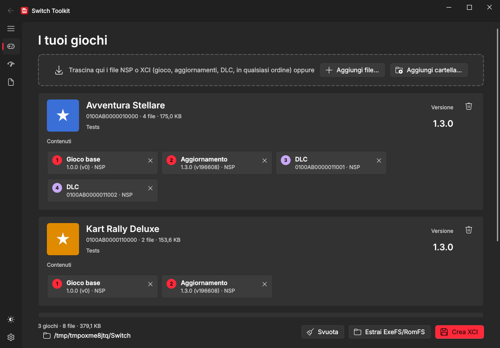
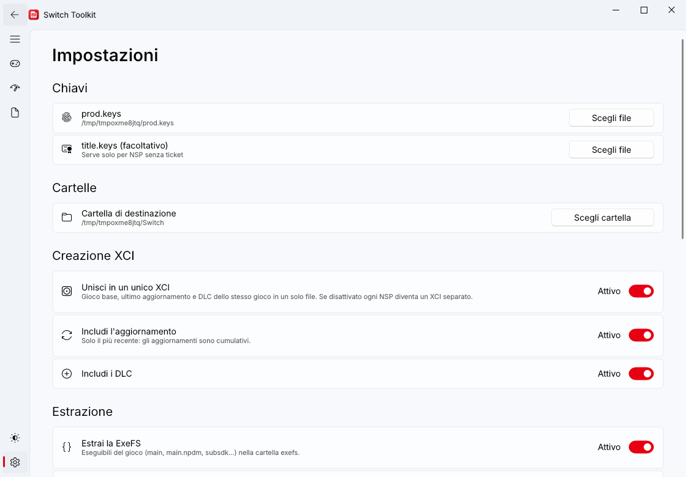

# Switch Toolkit

Programma per Windows che fa da coltellino svizzero per i file **Nintendo Switch**:

- **NSP → XCI**: converte un NSP in XCI;
- **unione in un unico XCI** di gioco base, aggiornamento e DLC;
- **estrazione di ExeFS e RomFS**, anche con l'aggiornamento già applicato.

> Il programma **non contiene chiavi**: serve il file `prod.keys` ricavato dalla
> **tua** console con Lockpick_RCM.
> Usalo solo con giochi di cui possiedi una copia (backup personali).



## Download

Scarica dalla pagina **Releases**:

| File | Cosa contiene |
|---|---|
| `SwitchToolkit-windows-x64.exe` | interfaccia grafica (Windows 10/11, 64 bit) |
| `switchtk-cli-windows-x64.exe` | riga di comando |

Non serve installare nulla: è un unico `.exe`.

## Prima di iniziare: le chiavi

1. Ricava `prod.keys` dalla tua console con Lockpick_RCM.
2. Mettilo in uno di questi posti (il programma lo trova da solo):
   - nella stessa cartella di `SwitchToolkit.exe`;
   - in `%APPDATA%\SwitchToolkit\prod.keys`;
   - in `%USERPROFILE%\.switch\prod.keys`;
   - nella cartella delle chiavi di un emulatore (`%APPDATA%\yuzu\keys`,
     `suyu`, `sudachi`, `citron`, `eden`, `%APPDATA%\Ryujinx\system`);

   oppure sceglilo in **Impostazioni → Chiavi**.
3. `title.keys` è facoltativo: serve solo per gli NSP che non contengono il
   ticket (`.tik`).

Se un gioco richiede un firmware più recente di quello da cui hai ricavato le
chiavi, il programma te lo dice: aggiorna la console e rigenera `prod.keys`.

## Uso (interfaccia grafica)

1. Trascina nella pagina **Giochi** i file `.nsp` / `.xci`, oppure usa
   **Aggiungi file…** / **Aggiungi cartella…**. Puoi aggiungere insieme gioco
   base, aggiornamenti e DLC, in qualsiasi ordine: vengono raggruppati per
   gioco, con icona, nome e versione.
2. In basso scegli la **cartella di destinazione**.
3. Premi:
   - **Crea XCI**: per ogni gioco crea un XCI con gioco base, **ultimo**
     aggiornamento e tutti i DLC (gli aggiornamenti sono cumulativi, quelli più
     vecchi vengono ignorati). Con un solo NSP è una semplice conversione
     NSP → XCI. Il file si chiama ad es.
     `Nome Gioco [0100ABCD00010000][v196608][+2 DLC].xci`;
   - **Estrai ExeFS/RomFS**: crea `Nome Gioco [TITLEID]\exefs` e `\romfs`.
     Se è presente l'aggiornamento, la RomFS e la ExeFS sono quelle della
     versione aggiornata (la RomFS viene ricostruita a partire dal gioco base,
     che quindi serve anche lui).
4. La pagina **Avanzamento** mostra percentuale, velocità e tempo rimanente;
   **Registro** contiene i dettagli.



**Impostazioni**:

- **Creazione XCI**: *Unisci in un unico XCI* (se disattivato ogni NSP diventa
  un XCI separato), *Includi l'aggiornamento*, *Includi i DLC*.
- **Estrazione**: ExeFS sì/no, RomFS sì/no, *RomFS come unico file*
  (`romfs.bin` invece della cartella), *Applica l'aggiornamento*.
- **Aspetto**: tema chiaro/scuro/di sistema, lingua italiano/inglese.
- **Aggiornamenti**: all'avvio il programma controlla se su GitHub c'è una
  nuova versione. Se c'è, un avviso permette di leggere le novità e di
  **aggiornare con un clic**: il nuovo `.exe` viene scaricato, verificato
  (SHA-256), sostituito e il programma si riavvia. C'è anche **Controlla ora**.

Le impostazioni sono salvate in `%APPDATA%\SwitchToolkit\config.json`.

| Giochi (scuro) | Impostazioni (chiaro) |
|---|---|
|  |  |

## Uso (riga di comando)

```bat
switchtk-cli info gioco.nsp aggiornamento.nsp --files
switchtk-cli xci gioco.nsp aggiornamento.nsp dlc1.nsp dlc2.nsp -o D:\Switch\XCI
switchtk-cli xci --no-merge gioco.nsp -o D:\Switch\XCI
switchtk-cli extract gioco.nsp aggiornamento.nsp -o D:\Switch\Estratti
switchtk-cli extract gioco.xci -o D:\Switch\Estratti --romfs-bin --no-update
switchtk-cli verify gioco.nsp
switchtk-cli --keys C:\chiavi\prod.keys info D:\Switch\NSP
```

Al posto dei file si possono indicare cartelle. Opzioni di `xci`:
`--no-merge` (un XCI per file), `--no-update`, `--no-dlc`, `--force` (non
controlla lo spazio libero). Opzioni di `extract`: `--no-exefs`, `--no-romfs`,
`--romfs-bin`, `--no-update`. `verify` controlla l'impronta SHA-256 di ogni NCA
di un NSP rispetto ai metadati. La lingua segue quella del sistema; per
sceglierla: `set SWITCHTK_LANG=en` oppure `it`.

## Come funziona

- **NSP → XCI**: gli NCA non vengono decifrati né ricompressi. Cambia solo
  l'intestazione di ciascun NCA (0xC00 byte): il tipo di distribuzione diventa
  "scheda di gioco" e, per gli NCA protetti da ticket, la title key viene
  scritta nell'area chiavi dell'NCA, perché un XCI non contiene ticket. Poi
  viene scritta la struttura XCI (intestazione + partizioni HFS0 `update`,
  `normal`, `secure`). La conversione è veloce quanto una copia del file.
- **Estrazione**: ExeFS (PFS0) e RomFS vengono decifrate (AES-CTR). Per un
  aggiornamento, la RomFS è una patch **BKTR**: il programma ricostruisce la
  RomFS completa leggendo i blocchi invariati dal gioco base e quelli nuovi
  dall'aggiornamento.

## Note e limiti

- L'intestazione dell'XCI non è firmata da Nintendo (nessun programma di questo
  tipo può farlo): gli XCI funzionano con gli **emulatori** e con gli installer
  e loader **homebrew**, non come scheda fisica.
- Dopo la conversione l'impronta SHA-256 degli NCA modificati non corrisponde
  più ai metadati: è normale per tutti gli XCI convertiti da NSP. Gli emulatori
  non la controllano; se un installer homebrew la verifica, disattiva quel
  controllo.
- File **compressi** (NSZ, XCZ, NCZ) non supportati: decomprimili prima, ad
  esempio con `nsz -D`.
- NSP con **ticket personalizzato** (legato alla console, come gli acquisti
  scaricati senza conversione) non sono supportati: riesegui il dump
  rimuovendo i dati specifici della console, oppure aggiungi la title key in
  `title.keys`.
- Gli aggiornamenti **delta** non sono supportati.
- L'estrazione di alcuni giochi molto recenti, che usano NCA **compressi** o
  **sparse**, non è ancora supportata (il programma lo segnala). La creazione
  dell'XCI funziona comunque.
- Gli XCI più grandi di 4 GB non stanno su una scheda SD formattata FAT32:
  usa exFAT.

## Compilare da sorgente

Serve Python 3.10 o successivo.

```bat
build.bat
```

oppure manualmente:

```bat
pip install -r requirements.txt pyinstaller pillow
set QT_QPA_PLATFORM=offscreen
python -m unittest discover -s tests
set QT_QPA_PLATFORM=
pyinstaller --onefile --windowed --name SwitchToolkit --icon assets\switchtk.png --add-data "assets\switchtk.png;assets" switchtk_gui.py
pyinstaller --onefile --console --name switchtk-cli --exclude-module PySide6 --exclude-module qfluentwidgets switchtk_cli.py
```

Da sorgente si avvia anche con `python switchtk_gui.py` (GUI) o
`python -m switchtk` (riga di comando). I test usano file Switch finti generati
al momento, con chiavi casuali: non servono chiavi o giochi veri.

## Pubblicare una release

Ogni push compila l'eseguibile con GitHub Actions (scheda **Actions** →
*Build* → artefatti). Per pubblicare una release:

1. aggiorna `__version__` in `switchtk/__init__.py` e aggiungi la sezione
   `## vX.Y.Z` in [`CHANGELOG.md`](CHANGELOG.md);
2. crea il tag `vX.Y.Z`, oppure **Actions → Build → Run workflow** scrivendo
   la versione nel campo del tag.

La release contiene `SwitchToolkit-windows-x64.exe` (il nome che
l'aggiornamento dall'app cerca) e `switchtk-cli-windows-x64.exe`. Per correggere
la descrizione di una release già pubblicata, modifica la sua sezione e avvia
*Run workflow* con il tag e l'opzione **Solo note**. L'aggiornamento dall'app
funziona solo se il repository è **pubblico**.

## Licenza

GPL-3.0. Switch Toolkit non è affiliato a Nintendo. "Nintendo Switch" è un
marchio dei rispettivi proprietari.
